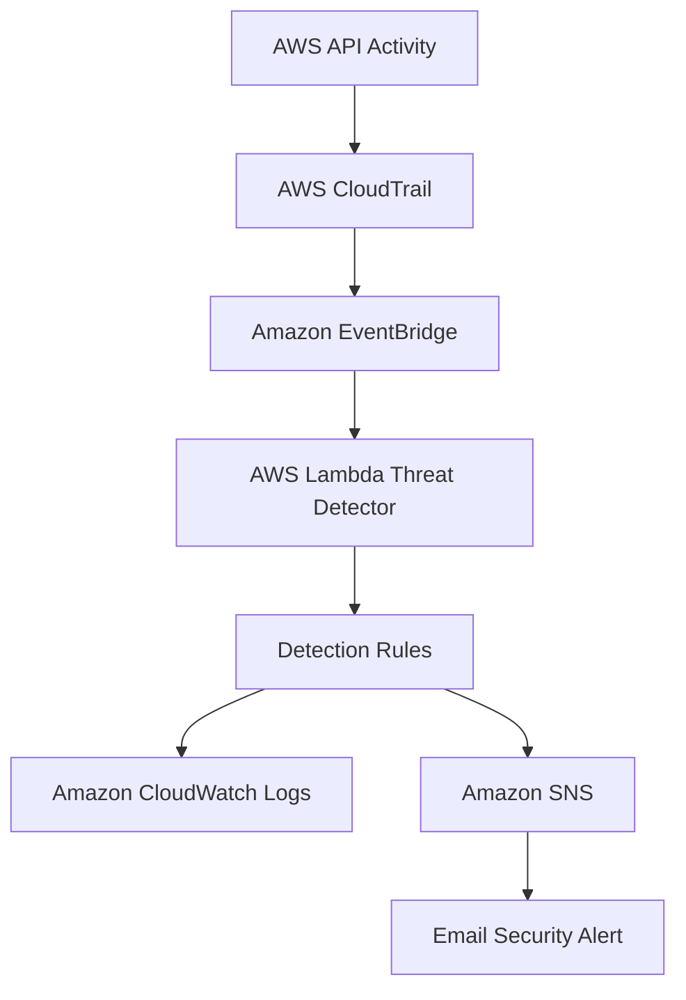

# AWS Cloud Threat Detection System


A cloud security monitoring and detection project built with Python and AWS. The system analyzes AWS CloudTrail activity, detects suspicious events, runs detection logic in AWS Lambda, records findings in CloudWatch Logs, and sends high-severity security alerts through Amazon SNS.

## Project Overview

This project demonstrates a practical cloud threat-detection pipeline using AWS security services and Python.

It began as a local Python detection engine using simulated CloudTrail logs and was later extended into a live AWS event-driven architecture.

The project demonstrates:

- Cloud security monitoring
- AWS CloudTrail analysis
- Detection engineering
- Event-driven security automation
- Serverless security tooling
- Automated alerting
- Python unit testing
- CI/CD with GitHub Actions

## Architecture



## Live AWS Pipeline

1. AWS API activity is recorded by CloudTrail.
2. EventBridge monitors selected CloudTrail events.
3. Matching events are sent to AWS Lambda.
4. Python detection logic analyzes the event.
5. Findings are written to CloudWatch Logs.
6. HIGH-severity findings are published to Amazon SNS.
7. SNS sends an email security alert.

## Detection Rules

### AWS-001 — CloudTrail Deletion Activity

Detects the `DeleteTrail` API call and generates a HIGH-severity security finding.

### AWS-002 — Repeated Failed Logins

Detects three failed AWS Console login attempts from the same source IP within five minutes.

The repeated-login correlation currently operates in the local detection engine. Stateful correlation across Lambda invocations is planned as a future enhancement.

## Technologies

- Python
- AWS CloudTrail
- AWS Lambda
- Amazon EventBridge
- Amazon SNS
- Amazon CloudWatch Logs
- Amazon S3
- AWS IAM
- Git
- GitHub
- GitHub Actions
- JSON
- Python unittest

## Features

- CloudTrail event analysis
- Serverless threat detection
- HIGH-severity email alerting
- Failed-login detection
- Time-window brute-force detection
- CloudWatch security logging
- Least-privilege SNS permissions
- Six automated Python tests
- GitHub Actions continuous integration
- Synthetic security testing

## Testing

Run the local detector:

```bash
python threat_detector.py
```

Run automated tests:

```bash
python -m unittest -v test_threat_detector.py
```

Expected result:

```text
Ran 6 tests
OK
```

## Security Practices

- No AWS credentials are stored in the repository
- Account-specific identifiers are replaced with placeholders
- Potentially destructive actions are tested with synthetic events
- Lambda uses an IAM execution role
- SNS publishing is limited to the security-alert topic
- CloudTrail logging and log file validation are enabled

## Future Improvements

- DynamoDB-based stateful login correlation
- Detect `StopLogging`
- Detect suspicious IAM privilege escalation
- Root-account activity detection
- Security-group exposure detection
- MITRE ATT&CK mappings
- Terraform or CloudFormation deployment
- Security monitoring dashboard

## Author

**Herbert Forson**

Computer and Information Sciences student focused on cloud security, cybersecurity, AWS, and security engineering.
